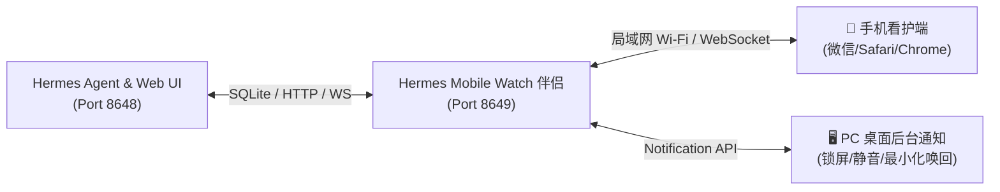

# Hermes Mobile Watch 🛡️
> 专为 Hermes Web UI (Ekko Studio) 打造的轻量级、零侵入、全设备实时看护与即时审批伴侣。

[](LICENSE)
[](https://nodejs.org/)
[](https://github.com/)
[](https://gemini.google.com)

---

## 💡 为什么需要它？

在使用 Hermes 等自主 AI Agent 时，Agent 经常需要在后台执行敏感 Shell 命令并触发**人工授权（Approval）**或**提问确认（Clarify）**。然而：
* 当你在 PC 上切到其他软件干活、写代码或看文档时，标签页静音运行，**极易漏掉审批**，导致任务长时间卡住停滞；
* 离开电脑去泡咖啡、上洗手间或开会时，无法随时随地感知 Agent 进展并快速放行。

**Hermes Mobile Watch** 应运而生：通过同局域网 WebSocket 实时同步，让你在**手机移动端**或 **PC 桌面后台**随时随地极速审批与看护，Agent 永不卡壳！



---

## 🌟 核心特性

### 1. 🖥️ PC 桌面后台系统级弹窗看护
* **全局常驻通知**：无论 Chrome 最小化还是在玩游戏、写代码，有审批时右下角直接弹出系统级原生通知。
* **静音免疫 (`requireInteraction`)**：弹窗持久停留，即使电脑静音也绝不漏掉。
* **点击直达与窗口唤醒**：点击通知瞬间**自动拉起并激活浏览器对应标签页**，居中弹出极速审批弹窗，无需翻找聊天记录！

### 2. 📱 手机触控优化与强感官提醒
* **专为移动端打造**：支持微信扫码、Safari、Android Chrome 打开，配备大号触控按钮（允许执行一次 / 本次会话允许 / 永久允许 / 拒绝）。
* **声音 + 震动**：内置 Web Audio API 蜂鸣音与 Vibration API，手机放桌上即可听声辨位。
* **常亮看护**：支持 Screen Wake Lock 保持屏幕常亮不锁屏。

### 3. 💬 标准 Chat 对话流与无感历史回溯
* **自然聊天布局**：最新回复与实时流处于最底部，打开页面自动精准滚至最新回复末尾。
* **按需顶端加载**：向上滑动平滑查看前序历史对话，滑到顶端支持增量加载更早记录，滚动位置平滑锁定不跳动。
* **完整 Markdown & 思考链**：完整呈现代码高亮、表格、独立「📋 复制」及思考过程折叠块。

### 4. 🔄 多会话自由切换与思考链状态监测
* **活动会话胶囊**：顶部实时显示所有正在运行的会话及其最新思考状态（Thinking State）。
* **下拉快速切换**：支持下拉列表在不同历史会话间极速切屏，绿灯实时指示活动状态。

### 5. 🛡️ 零侵入热插拔架构
* 完全独立运行（默认端口 8649），不修改 Hermes Agent 和 Hermes Web UI 的核心代码与数据库结构。
* 即使伴侣服务随时关闭或重启，主程序丝毫不受影响。

---

## 🚀 30 秒极速上手

### 1. 克隆项目到 Hermes 配置目录
```bash
git clone https://github.com/git100dr/hermes-mobile-watch.git ~/.hermes-web-ui/mobile-watch
cd ~/.hermes-web-ui/mobile-watch
```

### 2. 启动看护服务
```bash
./mobile-watch.sh start
```
> 服务启动后，终端将自动打印**手机直达局域网链接**及**ASCII 二维码**。手机连接同一 Wi-Fi，打开微信或相机扫码即可直达！

### 3. 可选：为 PC 浏览器注入右下角看护挂件
```bash
./mobile-watch.sh install-widget
```
> 注入后刷新 PC 网页（`http://localhost:8648`），右下角将常驻看护悬浮球，支持一键在桌面弹窗与扫码间切换。若需恢复原生界面，随时运行 `./mobile-watch.sh uninstall-widget`。

---

## 🛠️ 运维管理命令

```bash
# 查看运行状态与连接统计
./mobile-watch.sh status

# 在终端重新显示二维码与局域网链接
./mobile-watch.sh qr

# 重启伴侣服务
./mobile-watch.sh restart

# 停止伴侣服务
./mobile-watch.sh stop
```

---

## ⚙️ 配置说明 (`config.json`)

系统在首次启动时会自动根据 `config.example.json` 生成私密 `config.json`：

| 配置项 | 默认值 | 说明 |
| :--- | :--- | :--- |
| `port` | `8649` | 移动伴侣服务监听端口 |
| `hermesUrl` | `http://127.0.0.1:8648` | 本地 Hermes Web UI 访问地址 |
| `username` | `admin` | Hermes Web UI 登录账号 |
| `password` | `your_password` | Hermes Web UI 登录密码（用于自动放行审批） |
| `ntfyTopic` | `""` | 可选：远程 ntfy.sh 推送 Topic（支持远程穿透提醒） |
| `soundAlert` | `true` | 是否启用网页提示音 |
| `vibrateAlert` | `true` | 是否启用手机震动提醒 |
| `autoApprove.enabled` | `false` | 是否开启全局/指定会话命令免密自动放行 |

---

## 常见问题 (FAQ)

**Q: 手机扫码无法打开页面？**  
A: 请确保手机与电脑连接在同一个 Wi-Fi（局域网）下；若在 WSL2 中运行，请确保 WSL2 端口未被 Windows 防火墙拦截。

**Q: 如何开启桌面后台通知权限？**  
A: 在 PC 浏览器打开 `http://localhost:8648` 或 `http://localhost:8649` 时，点击浏览器地址栏左侧的锁头图标，将「通知 (Notifications)」权限设置为「允许」。

---

## 📄 开源许可证

本项目基于 [MIT License](LICENSE) 开源发布。

---

## 🙏 致谢 / Acknowledgements

本项目在架构设计、移动端前端适配与全链路联调过程中，由 **Gemini / Antigravity AI** 辅助结对编程共同构建完成。
特别感谢开源社区对自主智能体（Autonomous Agent）生态的持续探索与贡献！

